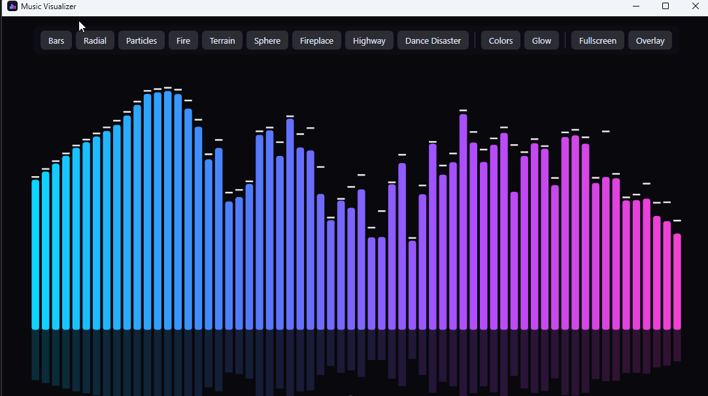
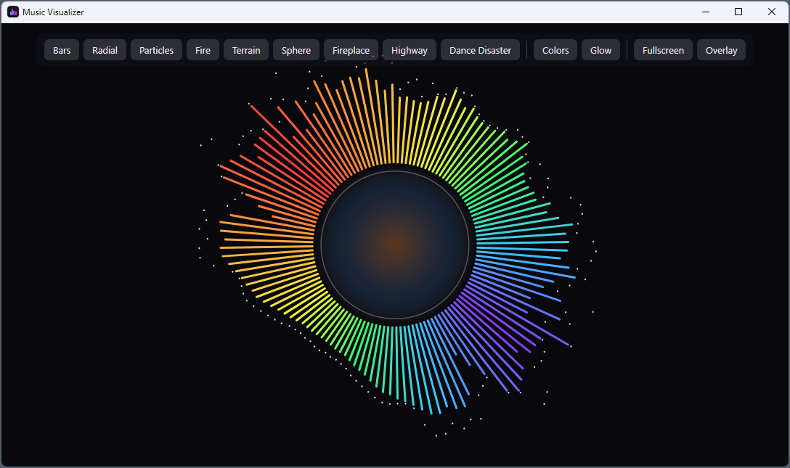
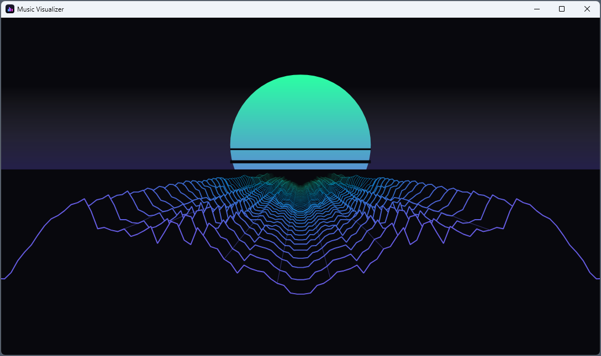
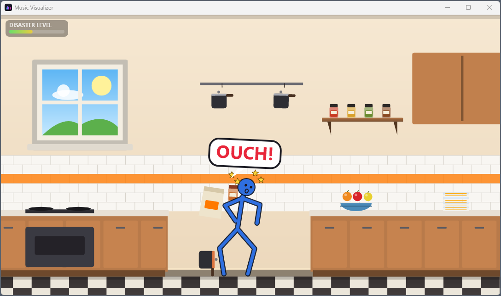
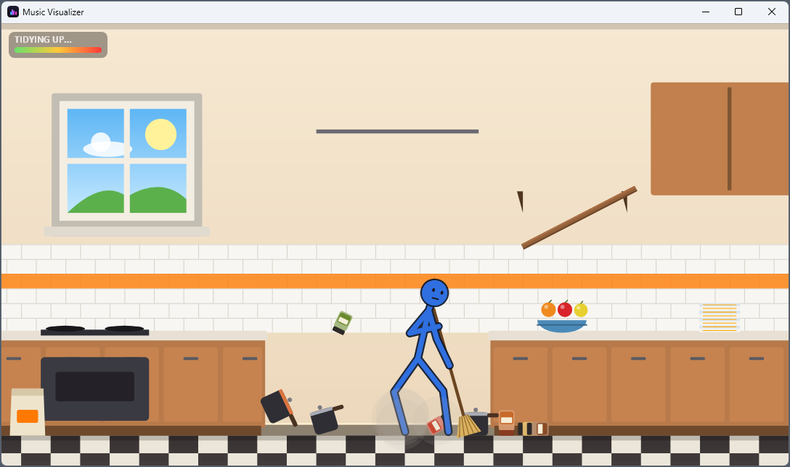
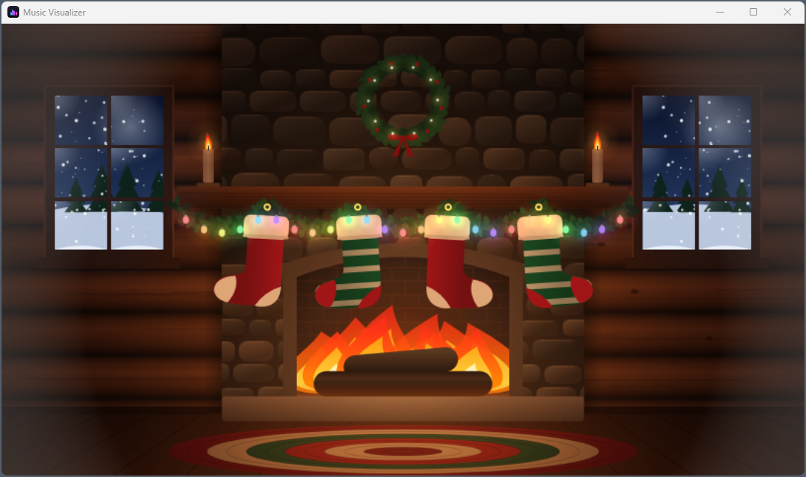
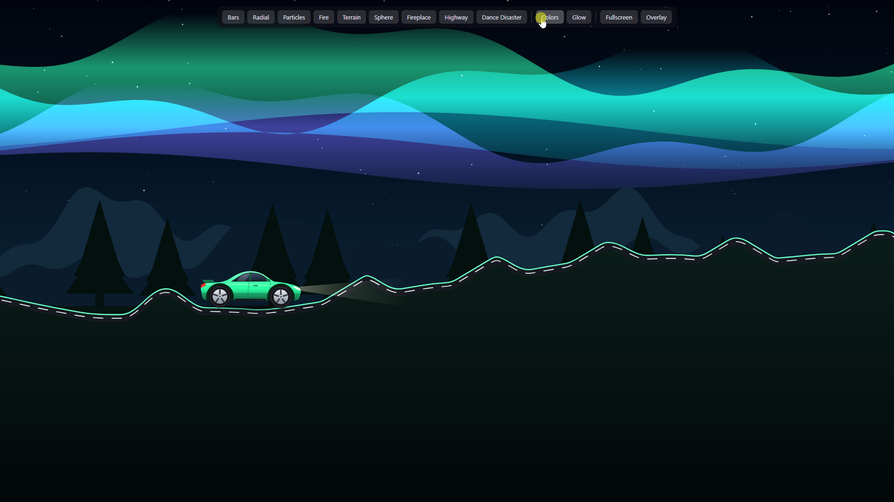
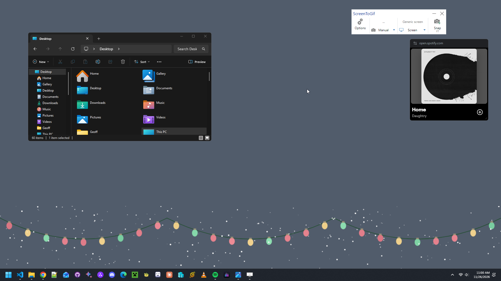
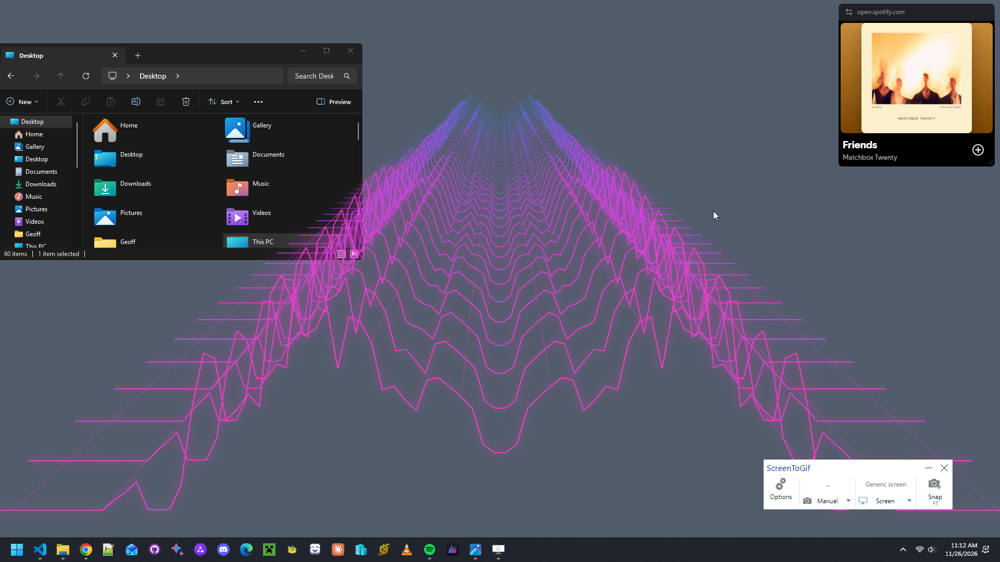
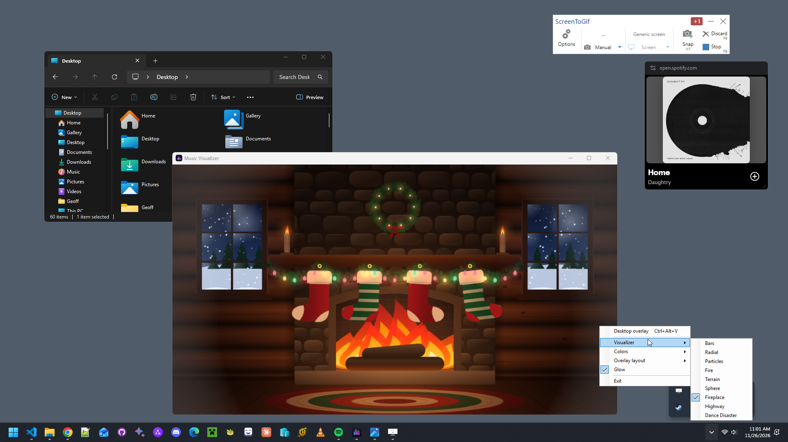

# Music Visualizer

A real-time music visualizer for Windows. It listens to whatever your PC is playing (Spotify, YouTube, games, anything) and turns it into animated visuals. There's no setup and no audio routing: it captures the default output device directly. It can also listen to a **microphone** for live music in the room.

It runs as a normal window, full screen, or as a **click-through desktop overlay** that sits on top of your work while you keep using the PC underneath.



## Download

1. Go to the [latest release](https://github.com/gmhultman/MusicVisualizer/releases/latest) and download **MusicVisualizer-win-Setup.exe**.
2. Run it. The app isn't code-signed, so Windows SmartScreen may warn you: click **More info → Run anyway**.
3. It installs for your user account only (no admin needed) and adds Desktop and Start menu shortcuts.

The app updates itself: it checks for a new version shortly after starting, downloads it in the background, and offers **Restart to update** in the tray menu. If you don't restart, the update installs the next time you exit. To uninstall, use **Settings → Apps**.

## Features

- **System audio capture**: uses WASAPI loopback on the default playback device and follows it automatically when you switch outputs (for example, when you plug in headphones).
- **Microphone input**: visualize live music, instruments or singing in the room, with a microphone picker, a sensitivity control and a live level meter.
- **11 visualizers in three groups**
  - *Abstract*
    - **Bars**: classic spectrum bars with peak caps and a floor reflection
    - **Radial**: spectrum spokes radiating from a bass-pulsing core, slowly rotating
    - **Particles**: bursts on every beat, colored by the frequency band that spawned them
    - **Sphere**: a 3D globe of glowing points that bulges with the music, circled by orbit rings
  - *Nature*
    - **Fire**: a wall of flames that rises with the music and throws embers on beats
    - **Terrain**: a 3D synthwave landscape built ridge by ridge from the spectrum
  - *Scenes*
    - **Fireplace**: a cozy log-cabin Christmas scene with flames, swinging stockings and twinkling lights
    - **Highway**: a car drives over hills generated live from the music, catching air off the crests
    - **Dance Disaster**: a stick figure dances while the room falls apart around it, with things getting knocked off the walls and shelves as the music gets louder; when it calms down, the dancer sweeps up and the room puts itself back together
    - **Aquarium**: a school of fish that darts on the beat, swaying kelp, pulsing jellyfish and a treasure chest that bursts with bubbles on the bass
    - **Space**: a starfighter cruises past planets and through asteroid fields, warping on the drops; when the music gets intense, enemy ships warp in for a laser dogfight
- **8 color palettes plus your own**: Neon, Sunset, Aurora, Fire, Ice, Rainbow, Christmas and Candy Cane, plus an optional glow effect.
- **Custom color palettes**: make your own with 2–6 colors.
- **Auto-cycle**: change the visualizer and/or colors every few minutes or on each new song, optionally shuffled. New songs are detected from apps that report what's playing to Windows (Spotify, browsers, Media Player and so on), falling back to the silence between tracks.
- **Pick your favorites**: switch off visualizers you don't want and they're hidden from the toolbar, tray menu, arrow keys and cycling. Palettes can be left out of cycling too.
- **Smooth fades** between visualizers.
- **Desktop overlay**: click-through, either as a strip along the bottom of the screen or full screen, with adjustable **overlay opacity**.
- **Tray icon and global hotkeys**: control the app even while it's an overlay.
- **Screensaver blocking**: keeps the display awake while music is playing and lets Windows sleep normally once it's quiet.
- **Remembers your settings**: visualizer, palette, mode, window position, sound source and microphone, enabled visualizers and palettes, custom palettes, auto-cycle, fade and opacity options are saved to `%APPDATA%\MusicVisualizer\settings.json`.

Most options live in the [Settings window](#settings).

## Screenshots

<table>
  <tr>
    <td width="50%"><br><b>Radial</b>, Rainbow palette</td>
    <td width="50%"><br><b>Terrain</b></td>
  </tr>
  <tr>
    <td><br><b>Dance Disaster</b>: the room starts falling apart</td>
    <td><br>…and the dancer tidies up when the music calms down</td>
  </tr>
  <tr>
    <td><br><b>Fireplace</b></td>
    <td><br><b>Highway</b> in fullscreen, Aurora palette</td>
  </tr>
</table>

### Desktop overlay and tray menu

<table>
  <tr>
    <td width="50%"><br>Overlay as a strip along the bottom of the screen</td>
    <td width="50%"><br>Full-screen overlay: click-through, so you keep working underneath</td>
  </tr>
  <tr>
    <td colspan="2"><br>The tray menu: switch visualizer, palette or overlay layout from anywhere</td>
  </tr>
</table>

## Controls

### Global hotkeys (work anywhere)

| Keys | Action |
| --- | --- |
| `Ctrl+Alt+V` | Toggle between desktop overlay and window |
| `Ctrl+Alt+N` | Next visualizer |
| `Ctrl+Alt+C` | Next color palette |

### In the window

| Key | Action |
| --- | --- |
| `←` / `→` / `Space` | Previous / next visualizer |
| `C` | Next color palette |
| `G` | Toggle glow |
| `S` | Open settings |
| `O` | Switch to desktop overlay |
| `F11` / `F` | Toggle fullscreen |
| `Esc` | Leave fullscreen |

Move the mouse to show the toolbar. It has a dropdown for each visualizer category (**Abstract ▾**, **Nature ▾**, **Scenes ▾**); the category that's showing is highlighted.

### Tray icon

Left-click the tray icon to bring back the window. Right-click it for a menu where you can toggle the overlay, pick a visualizer (grouped by category), palette or overlay layout, turn glow, **Auto-cycle** or **Listen to microphone** on or off, open **Settings…**, check for updates, or exit. The menu also shows which version you're running.

## Settings

Open the Settings window with the **Settings** button on the toolbar, the `S` key, or **Settings…** in the tray menu. Changes apply immediately.

- **Sound**: listen to what the PC is playing or to a microphone; pick the microphone and its sensitivity, with a live level meter.
- **Visualizers**: choose which visualizers are switched on, grouped into collapsible categories.
- **Auto-cycle**: change the visualizer and/or colors on a timer or with each new song, in order or shuffled.
- **Colors**: create, edit and delete custom palettes, and choose which palettes are included when cycling.
- **Display**: fade transitions between visualizers, glow, and overlay opacity.

## Requirements

- Windows 10 (version 1809 or later) or 11
- [.NET 8 SDK](https://dotnet.microsoft.com/download/dotnet/8.0) to build. The published exe is self-contained and needs no runtime installed.

## Build and run

```powershell
dotnet run --project src/MusicVisualizer.App
dotnet test MusicVisualizer.slnx
```

## Releasing a new version

```powershell
./release.ps1 1.0.1 -Notes 'What changed'
```

The script checks that `main` is committed, pushed and passing its tests, then tags the commit `v1.0.1` and pushes the tag. That starts the [Release workflow](.github/workflows/release.yml), which builds the app, packs the installer and delta update with [Velopack](https://velopack.io), and publishes them as a GitHub release. Installed copies find the update on their next start.

## Local install without the installer

`publish.ps1` builds an optimized, self-contained, single-file `MusicVisualizer.exe` and copies it to an install folder:

```powershell
./publish.ps1                                   # installs to E:\Apps\MusicVisualizer
./publish.ps1 -Destination 'C:\Apps\MusicVisualizer'
```

The script asks for admin rights only if the destination folder is protected (such as Program Files). If the installed copy is running, the script closes it first and relaunches it afterwards. A copy installed this way doesn't update itself.

## Project layout

```
src/MusicVisualizer.App/
  Audio/      loopback capture and FFT spectrum analysis
  Visuals/    the visualizers, palettes and shared rendering helpers (SkiaSharp)
  Services/   tray icon, global hotkeys, screensaver blocker, updater
  Settings/   persisted user settings
  Interop/    Win32 P/Invoke declarations
tests/MusicVisualizer.Tests/   xUnit tests
.github/workflows/release.yml  builds and publishes a release when a version tag is pushed
release.ps1                    tags and publishes a new version
publish.ps1                    local build and install script (no auto-update)
```

Built with WPF on .NET 8, [NAudio](https://github.com/naudio/NAudio) for audio capture, and [SkiaSharp](https://github.com/mono/SkiaSharp) for rendering.
